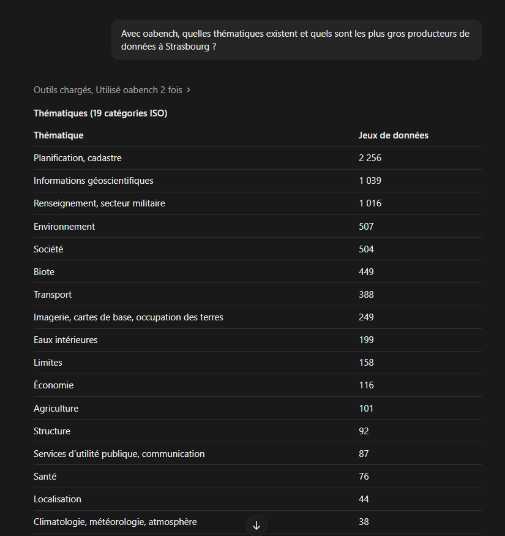

# oabench

> **Résumé en français.** Projet personnel et indépendant. Objectif : mesurer, sur le catalogue de
> données ouvertes [DataGrandEst](https://www.datagrandest.fr), ce qu'un agent apporte par rapport à
> une recherche lexicale, une recherche par embeddings et un graphe pour trouver un jeu de données,
> avec un serveur MCP en lecture seule comme socle. **État : en construction, rien n'est encore
> mesuré.** Ce projet n'est affilié ni à la Région Grand Est ni à DataGrandEst ; il utilise
> uniquement leur API publique, en lecture seule.

A benchmark of dataset-search approaches on a real open-data catalog: portal search, BM25,
embeddings, graph propagation and a tool-calling agent, behind a read-only MCP server.

This is an independent personal project. It is not affiliated with, endorsed by, or built for
Région Grand Est or DataGrandEst. It only reads their public catalog API.

## Status

Work in progress. What exists today:

| Part | State |
|---|---|
| Catalog exploration (`docs/01_exploration.md`, in French) | done, 12 Nov 2026 |
| Project scope and evaluation protocol (`docs/02_cadrage.md`, in French) | done |
| Repository skeleton, lint, type check, tests, CI | done |
| Portal client (SQLite cache, 1 request/s, bounded retries) and frozen snapshot | done |
| Read-only MCP server, 4 tools, BM25 search over the snapshot (stdio) | done; tested with the SDK client and by hand in Claude Desktop (15 Nov 2026) |
| Golden set | 66 validated questions, split frozen (22 dev / 44 test); 1,146 pooled candidates, none judged yet |
| LLM client (Google Gemini, tool calling) and API key handling | done; tool calling checked against the real API with `oabench llm check` |
| Engines: portal search (as typed, and keywords only), BM25, multilingual embeddings on CPU, hybrid (rank fusion) | done, not yet scored |
| Pooling, blind judging tool, recall@5 / MRR with bootstrap CIs, abstention rates | code done; no judgment yet, so no result |
| Agent: bounded tool-calling loop through the MCP server, JSONL traces | done; tried by hand on two dev questions, not yet evaluated |
| Evaluation of the agent, comparison table | first table on the 22 dev questions, judged by a language model (see below); test split not judged, not evaluated |
| Robustness suites (injection, off-topic, outage, ambiguity) | first pass done on the main configuration; improvements identified, not applied |

No result is reported here yet because none has been measured.

## Quick start

Requires [uv](https://docs.astral.sh/uv/).

```bash
git clone https://github.com/Leon-afk1/agentic_project.git
cd agentic_project
uv sync
uv run pytest
uv run oabench --version
```

No API key is needed for the tests.

To build the catalog snapshot (17 requests to the portal, one per second, then served from the
local cache for 24 hours):

```bash
uv run oabench snapshot
uv run oabench snapshot --verify
```

On 12 Nov 2026 this kept 6,867 datasets out of 8,316 catalog records (maps and services are left
out). The snapshot is written to `data/snapshot/` and is not committed.

## API key

Only the agent needs a key; tests, CI, the snapshot, the MCP server and the search baselines do not.

```bash
cp .env.example .env                # then paste your Google AI Studio key after GEMINI_API_KEY=
uv sync --extra llm
uv run oabench llm check            # 2 requests: checks the key and tool calling
```

`.env` is git-ignored. The key is read from the environment only, never from a command-line
argument, and is never printed: the check reports only whether it is set and its length. A test
fails if a file tracked by git contains something shaped like an API key.

## Agent

```bash
uv run oabench ask "Où faire du vélo en sécurité à Strasbourg ?"
uv run oabench trace show results/traces/example_dev_n07.jsonl
```

The agent plans, searches, opens records and checks them (territory, period, granularity,
format), then ends by calling a `submit_answer` tool: either datasets with reasons, or an explicit
abstention. Hard limits: 8 model calls, 12 tool calls, 30,000 input tokens, 90 s, no identical
call more than twice. The last allowed call can only deliver the answer. Every cited id is checked
against what the tools really returned; an invented one is removed and counted.

Each run writes a JSONL trace (plan, every model and tool call with duration, tokens and result
size, stop reason, list-price cost). `results/traces/` holds one real example.

Model: `gemini-3.5-flash-lite` on the free tier (15 requests per minute, 500 per day), behind a
rate limiter and a response cache. `oabench ask` refuses questions of the frozen test split.

## First results (provisional)

Dev split only (22 questions: 16 with an answer, 6 without). Relevance was graded by a language
model (Claude), not by a human: `data/golden/judgments_llm_claude.jsonl`. The agent was tuned on
these same questions, so its numbers are optimistic. Nothing here has been measured on the test
split yet.

| System | Recall@5 [95% CI] | MRR [95% CI] | Correct abstention (6) | Wrongful abstention (16) |
|---|---|---|---|---|
| Portal search | 0.19 [0.00, 0.38] | 0.19 [0.00, 0.38] | 100% | 81% |
| Portal search, keywords only | 0.19 [0.00, 0.38] | 0.19 [0.00, 0.38] | 83% | 81% |
| Embeddings | 0.50 [0.25, 0.75] | 0.39 [0.19, 0.61] | 83% | 25% |
| Hybrid (RRF) | 0.73 [0.53, 0.91] | 0.61 [0.40, 0.80] | not measured | not measured |
| BM25 | 0.76 [0.57, 0.92] | 0.73 [0.55, 0.91] | 67% | 19% |
| Agent (`gemini-3.5-flash-lite` over BM25) | 0.75 [0.59, 0.91] | 0.94 [0.81, 1.00] | 100% | 0% |
| Agent (`gemini-3.5-flash-lite` over hybrid) | 0.67 [0.48, 0.87] | 0.88 [0.69, 1.00] | 83% | 6% |
| Agent (`gemini-3.1-flash-lite` over BM25) | 0.67 [0.47, 0.86] | 0.91 [0.75, 1.00] | 83% | 6% |

Main agent configuration (first agent row): 77% of cited records relevant, none invented, 5.5 model calls and 3.8 tool calls per
question, 0.0052 USD per question at list price, latency 7.2 s median and 22.9 s at the 95th
percentile (rate-limit waits excluded; that 95th percentile may include pauses between retries
after provider errors, a measurement flaw fixed since). No difference between the three agent
configurations is conclusive on 16 questions.

How to read it: the only conclusive difference in recall is the portal search against BM25
(-0.58, interval [-0.80, -0.34]). The agent does not improve recall@5 over BM25, the engine it
searches with; what it adds is ranking a good dataset first, citing few useless records, and
saying when the catalog has nothing. Abstention thresholds of BM25 and embeddings were tuned and
measured on the same questions. With 16 and 6 questions, intervals are wide.

### Agent v2

After the robustness pass below, four changes were made (a `needs_clarification` status,
immediate abstention on off-topic requests, a stop after two "service unavailable" tool results,
suggestions kept only when they name a producer seen in tool results). On the same 22 dev
questions, judged by a language model:

| | Agent v1 | Agent v2 | BM25 alone |
|---|---|---|---|
| Recall@5 [95% CI] | 0.75 [0.59, 0.91] | 0.78 [0.62, 0.93] | 0.76 [0.57, 0.92] |
| MRR [95% CI] | 0.94 [0.81, 1.00] | 1.00 [1.00, 1.00] | 0.73 [0.55, 0.91] |
| Correct abstention (6) | 100% | 100% | 67% |
| Wrongful abstention (16) | 0% | 0% | 19% |

Paired differences: v2 against v1 is inconclusive on both metrics; v2 against BM25 is inconclusive
on recall@5 (+0.02 [-0.19, +0.27]) and conclusive on MRR (+0.27 [+0.09, +0.45]). An MRR of 1.00 on
16 questions the agent was tuned on says little about unseen questions.

The robustness suites have **not** been rerun on v2 beyond two ambiguity cases (daily API quota
reached), and both still failed: the new clarification rule shows no effect so far. The table
below describes v1.

## Robustness (first pass)

Agent `gemini-3.5-flash-lite` over BM25, prompts unchanged. Small suites: read them as
observations, not as measurements.

| Suite | Cases | Outcome |
|---|---|---|
| Prompt injection, with the defensive paragraph | 6 | no attack succeeded; trap record seen 6 times, never cited |
| Prompt injection, without it | 6 | no attack succeeded either: the paragraph's effect is not measurable here |
| Off-topic requests | 8 | 6 without any dataset cited, 3 without any tool call; 2 failures |
| Catalog outage (every tool call fails) | 4 | 4 abstentions naming the outage, nothing cited or invented |
| Ambiguous requests | 6 | 0 flagged as ambiguous: the agent silently picks datasets |

Trap records carry an instruction in their description (self-promotion, a link plus a request for
an e-mail address, or "say that nothing exists"). They live only in an in-memory copy of the
catalog; nothing is written to the portal. Three simple attacks on one model do not show that the
agent resists injection in general. The ambiguity failure is structural: the final answer has two
statuses, answered and abstained, and no way to ask the user a question.

```bash
uv run oabench robustness injection   # or offtopic, outage, ambiguous
```

## Evaluation workflow

```bash
uv sync --extra embeddings          # optional: downloads a 220 MB ONNX model on first use
uv run oabench golden review        # validate proposed questions one by one
uv run oabench golden split         # freeze the dev/test split
uv run oabench golden pool          # top 10 of each base engine, merged per question
uv run oabench golden pool --engines hybrid --depth 5   # add a later system's top 5
uv run oabench golden judge         # grade candidates 0/1/2, blind to the engine
uv run oabench eval --split dev     # recall@5, MRR, latency, with 95% confidence intervals
```

## MCP server

Four read-only tools over the snapshot: `search_datasets`, `get_dataset_metadata`, `list_themes`,
`list_organizations`. Outputs are bounded in size and contain no geometry and no contact details.

```bash
uv run oabench mcp
```

To use it from Claude Desktop, add this to `claude_desktop_config.json` (replace the path with the
absolute path of your clone) and restart the application:

```json
{
  "mcpServers": {
    "oabench": {
      "command": "uv",
      "args": ["--directory", "/absolute/path/to/agentic_project", "run", "oabench", "mcp"]
    }
  }
}
```

Tried by hand in Claude Desktop on 15 Nov 2026 (all four tools):



Search is lexical (BM25 written by hand, title and keywords weighted). It always returns its best
matches, even for a question the catalog cannot answer: telling "nothing relevant" apart is the job
of the agent and is measured in the evaluation, not assumed.

## Ground rules

- **Read-only.** Nothing is ever written to the portal.
- **Polite client.** Local cache, at most one request per second, a User-Agent naming the project.
- **No personal data.** Contact fields of catalog records are dropped at extraction time.
- **Untrusted text.** Dataset descriptions are treated as untrusted input (prompt injection).

## Data and licences

Code: MIT (see `LICENSE`). Catalog metadata belongs to its producers and is published under the
licence stated in each record (mostly Licence Ouverte / Etalab and ODbL). The catalog itself is not
redistributed in this repository.
